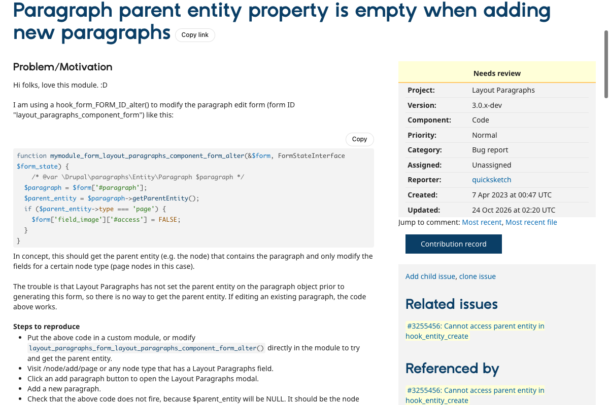
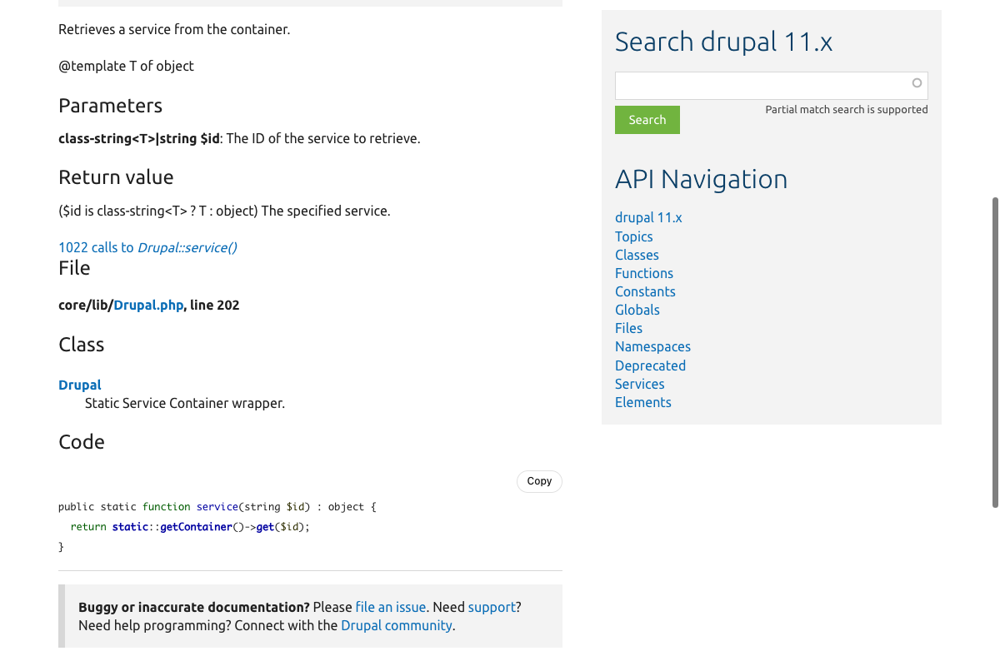
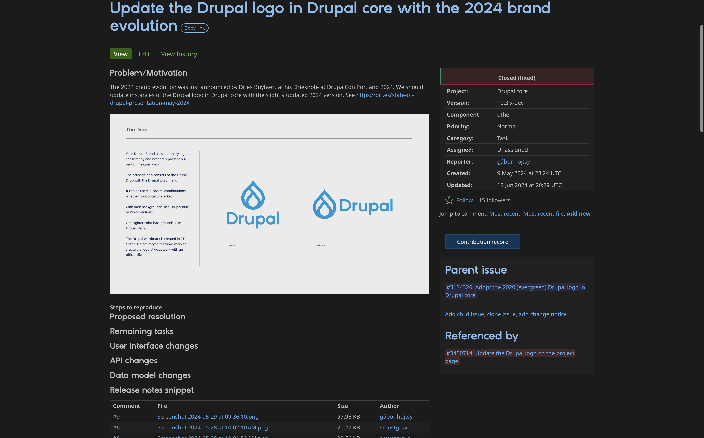
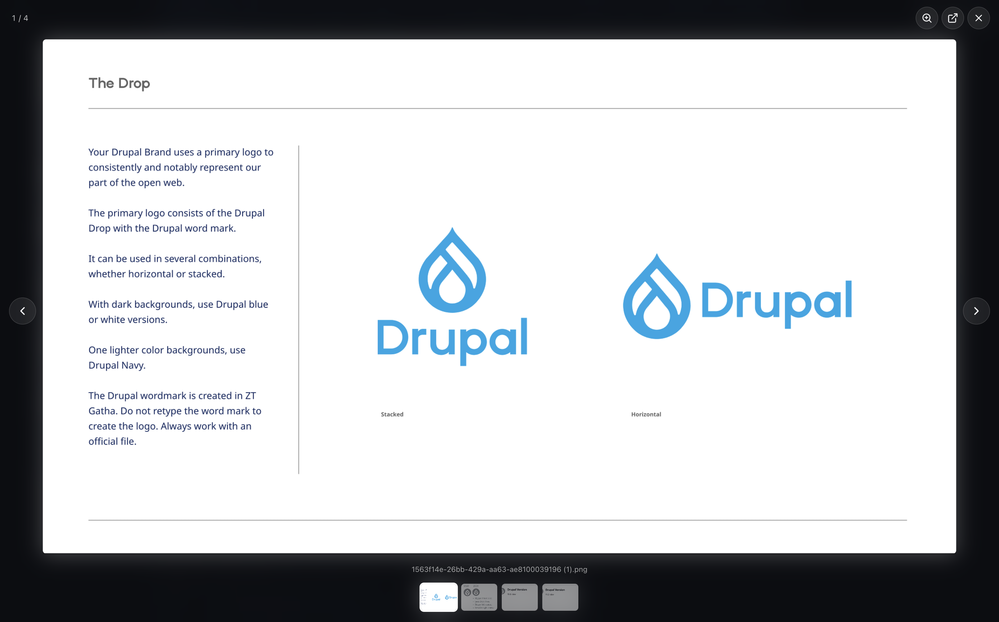
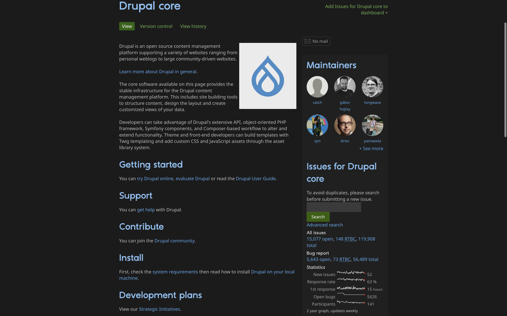
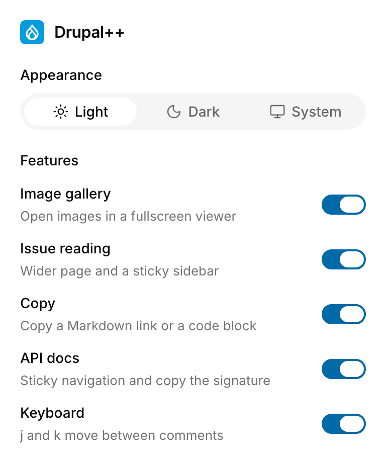
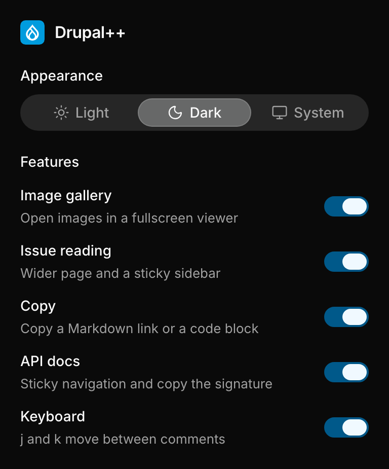

# Drupal++

Fullscreen image gallery, a dark theme, and reading tools for [drupal.org](https://www.drupal.org). Each one can be turned off in the popup. Load the folder unpacked from `chrome://extensions`.

**Appearance.** Light, Dark, or System. System follows the operating system.

**Image gallery.** Click an image to open it fullscreen.

**Issue reading.** The issue page gets wider, and the sidebar stays put while you scroll. The status, related issues, and contribution record stay in that column. When you are logged in, the comment form stays under the comments.

**Copy.** Copy link copies only the page address. Code blocks get a Copy button. Commit messages are left alone.

**API docs.** On [api.drupal.org](https://api.drupal.org), the side navigation stays fixed while you scroll.

**Keyboard.** `j` and `k` move between comments.

 

[MIT](LICENSE). Drupal and the Drupal logo are trademarks of Dries Buytaert.
