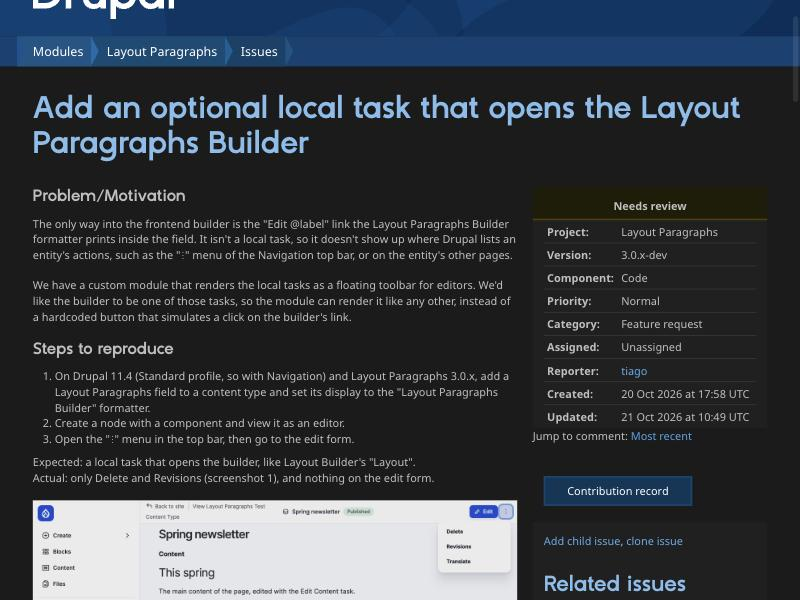
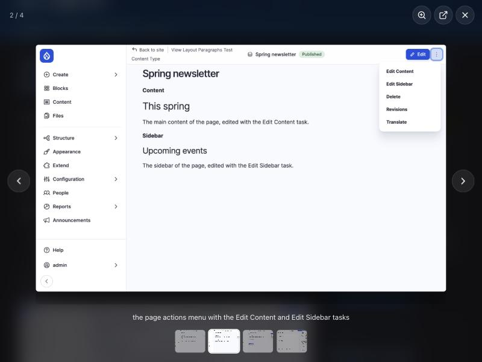
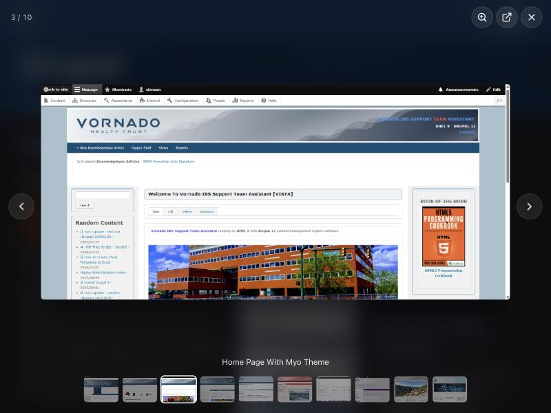
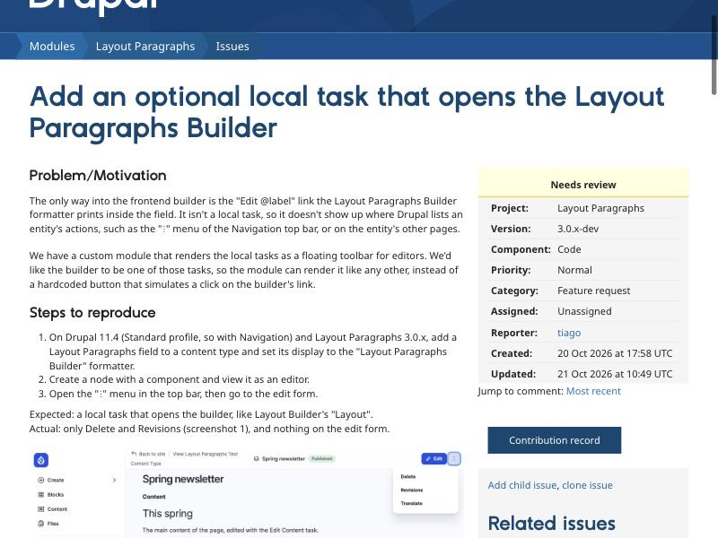
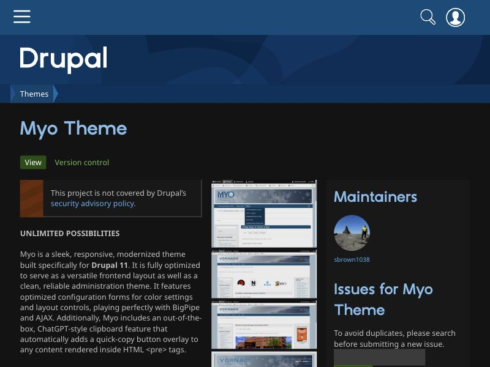
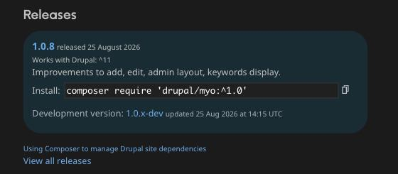
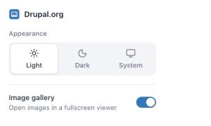
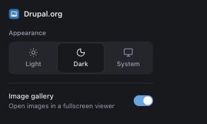

# Drupal.org Lightbox & Dark Mode

A Chrome extension for [drupal.org](https://www.drupal.org) that adds two things the site doesn't have:

- **A fullscreen image gallery.** Screenshots on projects, issues and comments open in a viewer instead of a new tab.
- **A dark theme.** You can pick Light, Dark or System, and System follows your OS.

It works in Chrome, Dia, Arc, Edge, Brave and any other Chromium browser.



## Image gallery

Click any image in the page content to open it fullscreen, over a dark, blurred backdrop. The image's alt text appears as a caption, with arrows, a counter and thumbnails of every image on the page.





- Links that point to an image file open in the gallery too, such as the attachments table of an issue. If an image is both shown inline and listed as an attachment, it appears only once.
- Project screenshots open as the original file, not the resized thumbnail.
- Avatars, icons and logos are left alone.
- Cmd/Ctrl-click still opens the image in a new tab.

| Key or gesture | Action |
| --- | --- |
| `←` `→`, swipe, trackpad swipe | Previous / next image |
| `Home` `End` | First / last image |
| Click the image, or `Z` | Zoom to actual size at that point. Drag to pan. |
| `Esc` | Leave zoom, then close |
| Click outside the image | Close |

## Dark mode

| Light | Dark |
| --- | --- |
|  |  |

The dark theme isn't a list of hand-written overrides. The extension reads drupal.org's own stylesheets and writes a dark copy of every rule that sets a colour:
- Backgrounds become dark.
- Text and links become light.
- Brand colours keep their hue.

The colours are shifted in the OKLab colour space, and colours set through CSS custom properties are resolved first. Because of this, new parts of the site get a dark version without changes to the extension.





The generated CSS is cached, so the next page opens dark straight away, without a white flash.

## Settings

Click the toolbar icon to choose the theme, or to turn the gallery off.

<p>
  
  
</p>

Settings are saved with `chrome.storage.sync`, so they follow your browser profile.

## Install

The extension isn't in the Chrome Web Store, so you load it unpacked:

1. Download the code: **Code → Download ZIP** on this page (and unzip it), or clone it.

   ```bash
   git clone https://github.com/tiagem/drupalorg-plus.git
   ```

2. Open `chrome://extensions`. In Dia and other Chromium browsers the same address works.
3. Turn on **Developer mode**.
4. Click **Load unpacked** and choose the `drupalorg-plus` folder.
5. Pin the icon to the toolbar if you want quick access to the settings.

To update, pull the latest code (or download it again) and click the reload button on the extension's card in `chrome://extensions`.

## Privacy

The extension runs only on `drupal.org` and its subdomains. Its only permission is `storage`, used for your two settings. It makes no network requests and collects nothing.

## Files

| Path | What it does |
| --- | --- |
| `manifest.json` | Manifest V3 definition |
| `src/theme.js` | Dark theme, runs at `document_start` |
| `src/lightbox.js` | Gallery, rendered in a Shadow DOM so the site's CSS can't affect it |
| `popup/` | Settings popup |
| `icons/` | Toolbar and store icons |
